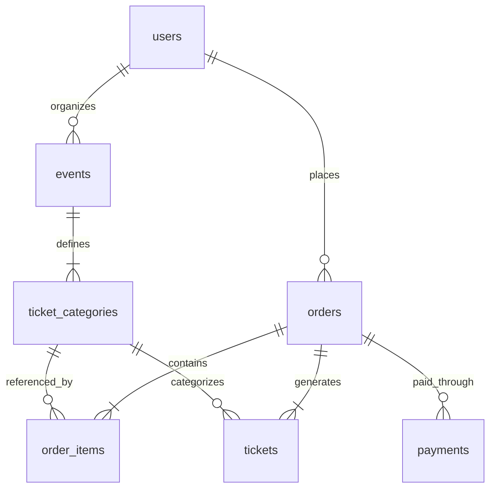

# Event & Ticketing Platform (TicketFlow)

[](https://laravel.com)
[](https://react.dev)
[](https://www.typescriptlang.org)
[](https://tailwindcss.com)
[](https://zustand-demo.pmnd.rs)
[]()
[]()

Production-ready, enterprise-grade decoupled Event and Ticketing Platform built with a Laravel 11 RESTful API backend and a high-performance React 19 + TypeScript + Tailwind CSS v4 Single Page Application (SPA).

---

## 📑 Table of Contents
1. [Architectural Overview](#-architectural-overview)
2. [Key Capabilities & Features](#-key-capabilities--features)
3. [Database Schema & ERD](#-database-schema--erd)
4. [Tech Stack](#-tech-stack)
5. [Directory Layout](#-directory-layout)
6. [API Endpoints Documentation](#-api-endpoints-documentation)
7. [Local Setup Instructions](#-local-setup-instructions)
8. [Demo Credentials](#-demo-credentials)
9. [Race Condition & Concurrency Strategy](#-race-condition--concurrency-strategy)
10. [Commit & Contribution Standards](#-commit--contribution-standards)

---

## 🏛 Architectural Overview

The platform uses a decoupled client-server architecture:
- **Backend API**: Adheres to the **Clean Architecture / Service-Repository Pattern**. The database layer is decoupled through contracts/interfaces, enabling high testability, transaction boundaries, and maintainability.
- **Frontend SPA**: Built with modern React 19, TypeScript, and Tailwind CSS v4. State is handled via Zustand stores with automatic `localStorage` persistence and token interceptors.
- **Security & Authorization**: Powered by Laravel Sanctum token-based authentication with role-based access control (`admin`, `organizer`, `customer`).
- **Ticket Verification Engine**: Generates unique cryptographic ticket identifiers and server-rendered vector QR codes (`simple-qrcode`) delivered as secure base64 payloads to mobile and web clients.

---

## 🌟 Key Capabilities & Features

### 1. Customer Experience
- **Interactive Event Catalog**: Dynamic search, category filters (Tech, Music, Business, Art, Workshop), status badges, and date sorting.
- **Event Detail & Tier Selection**: Live tier quota availability counters, tier descriptions, and dynamic subtotal calculations.
- **15-Minute Inventory Hold & Checkout**: Pessimistic database locking (`lockForUpdate`) combined with optimistic quota version increments prevents ticket overselling during peak traffic. Includes a live visual 15-minute countdown timer.
- **Mock Payment Sandbox**: Realistic payment gateway simulation with instant settlement toggle (Success / Decline) supporting QRIS, Virtual Accounts, Credit Cards, and E-Wallets.
- **Digital E-Tickets with QR Codes**: High-resolution vector QR code rendering directly from backend base64 payloads with one-click code copy and check-in status indicators.

### 2. Admin & Organizer Management
- **Analytics KPI Dashboard**: Real-time aggregation of Total Gross Revenue (IDR), Tickets Issued, Active Events, and Registered Users.
- **7-Day Sales Trend Chart**: Responsive SVG-based visual bar chart rendering day-by-day sales volume.
- **Event Inventory Management**: Full event lifecycle tracking (Draft, Published, Cancelled, Completed) with a built-in modal for launching new events and setting ticket tier quotas.

---

## 🗄 Database Schema & ERD

Comprehensive architecture and relational integrity specification is documented in [`docs/DATABASE_ERD_ARCHITECTURE.md`](docs/DATABASE_ERD_ARCHITECTURE.md).



### Core Entities:
- **`users`**: UUID primary key, full name, email, role (`admin`, `organizer`, `customer`), phone number, and account status.
- **`events`**: UUID, organizer foreign key, title, URL slug, description, category, venue details, dates, and publication status.
- **`ticket_categories`**: UUID, event reference, tier name, price, total quota, available quota, and concurrency `version` integer.
- **`orders`**: UUID, user reference, order reference number (`ORD-XXXXXX`), total amount, lifecycle status (`pending`, `paid`, `cancelled`, `expired`), and expiration timestamp.
- **`order_items`**: UUID, order foreign key, ticket category reference, quantity, unit price, and subtotal.
- **`payments`**: UUID, order reference, gateway transaction reference, payment method, payment status, and gateway JSON audit payload.
- **`tickets`**: UUID, order/category/user references, unique alphanumeric ticket code (`TKT-XXXXXX`), base64 SVG QR payload, gate status (`valid`, `used`, `revoked`), and check-in timestamp.

---

## 💻 Tech Stack

### Backend
- **Framework**: Laravel 11.x (PHP 8.3+)
- **Authentication**: Laravel Sanctum (UUID token morphs)
- **Database**: SQLite / MySQL / PostgreSQL (Database-agnostic migrations)
- **Architecture**: Service-Repository Pattern
- **QR Engine**: SimpleSoftwareIO QrCode (BaconQrCode)

### Frontend
- **Framework**: React 19.x + Vite 8.x
- **Language**: TypeScript 5.x
- **Styling**: Tailwind CSS v4 + `@tailwindcss/vite`
- **State Management**: Zustand 5.x
- **Icons**: Lucide React
- **HTTP Client**: Axios with Bearer Interceptors

---

## 📂 Directory Layout

```
.
├── backend/                             # Laravel 11 RESTful API
│   ├── app/
│   │   ├── Http/Controllers/Api/        # REST API Controllers
│   │   │   ├── AuthController.php
│   │   │   ├── EventController.php
│   │   │   ├── BookingController.php
│   │   │   └── AdminDashboardController.php
│   │   ├── Models/                      # Eloquent Domain Models (UUID)
│   │   │   ├── User.php
│   │   │   ├── Event.php
│   │   │   ├── TicketCategory.php
│   │   │   ├── Order.php
│   │   │   ├── OrderItem.php
│   │   │   ├── Payment.php
│   │   │   └── Ticket.php
│   │   ├── Repositories/                # Clean Architecture Repository Layer
│   │   │   ├── Contracts/               # Repository Interfaces
│   │   │   └── Eloquent/                # Concrete Eloquent Implementations
│   │   └── Services/                    # Domain Business Logic Layer
│   │       ├── AuthService.php
│   │       ├── EventService.php
│   │       ├── BookingService.php
│   │       └── AdminDashboardService.php
│   ├── database/migrations/             # Database Schema DDL
│   ├── database/seeders/                # Realistic Dummy Dataset
│   └── routes/api.php                   # Registered API Routes
│
├── frontend/                            # React 19 + TypeScript SPA
│   ├── src/
│   │   ├── components/layout/           # Navbar, Footer, Route Guards
│   │   ├── pages/                       # SPA Page Views
│   │   │   ├── HomePage.tsx             # Event Discovery & Catalog
│   │   │   ├── EventDetailPage.tsx      # Tier Selector & Hold Trigger
│   │   │   ├── CheckoutPage.tsx         # Hold Countdown & Mock Gateway
│   │   │   ├── MyTicketsPage.tsx        # Issued Passes & Vector QR View
│   │   │   ├── AdminDashboardPage.tsx   # Analytics & Event Creation
│   │   │   ├── LoginPage.tsx            # One-click Sandbox Login
│   │   │   └── RegisterPage.tsx
│   │   ├── services/                    # Axios API Client & Endpoints
│   │   ├── store/                       # Zustand Reactive Stores
│   │   └── types/                       # TypeScript Domain Contracts
│   └── package.json
│
└── docs/
    └── DATABASE_ERD_ARCHITECTURE.md     # ASD-STE100 Architecture Spec
```

---

## 📡 API Endpoints Documentation

All endpoints are prefixed with `/api/v1`.

### 1. Authentication (`/api/v1/auth`)
| Method | Endpoint | Auth | Description |
|---|---|---|---|
| `POST` | `/api/v1/auth/register` | None | Register new customer or organizer |
| `POST` | `/api/v1/auth/login` | None | Authenticate credentials and receive Sanctum Bearer token |
| `POST` | `/api/v1/auth/logout` | Bearer | Revoke active access token |
| `GET` | `/api/v1/auth/me` | Bearer | Retrieve authenticated user profile |

### 2. Events (`/api/v1/events`)
| Method | Endpoint | Auth | Description |
|---|---|---|---|
| `GET` | `/api/v1/events` | None | Browse public events with search, category filter, and pagination |
| `GET` | `/api/v1/events/{id_or_slug}`| None | Get event detail with available ticket categories |
| `POST` | `/api/v1/events` | Bearer (Admin/Organizer) | Create a new event with ticket category quotas |
| `PUT` | `/api/v1/events/{id}` | Bearer (Admin/Organizer) | Update event information |
| `DELETE`| `/api/v1/events/{id}` | Bearer (Admin/Organizer) | Remove event |

### 3. Bookings & Checkout (`/api/v1/bookings`)
| Method | Endpoint | Auth | Description |
|---|---|---|---|
| `POST` | `/api/v1/bookings/reserve` | Bearer | Lock quotas and create pending order with 15-minute hold |
| `POST` | `/api/v1/bookings/{orderId}/pay`| Bearer | Settle payment (success/failed), issue tickets and QR codes |
| `GET` | `/api/v1/orders` | Bearer | List authenticated user's order history |
| `GET` | `/api/v1/orders/{orderId}` | Bearer | Retrieve single order details |
| `GET` | `/api/v1/tickets` | Bearer | Retrieve authenticated user's active/past tickets with QR codes |

### 4. Admin Analytics (`/api/v1/admin`)
| Method | Endpoint | Auth | Description |
|---|---|---|---|
| `GET` | `/api/v1/admin/metrics` | Bearer (Admin) | Retrieve revenue, tickets sold, active events, and 7-day sales breakdown |

---

## 🚀 Local Setup Instructions

### Prerequisites
- PHP 8.2 or 8.3 with SQLite or MySQL PDO enabled
- Composer 2.x
- Node.js 18+ and npm

### 1. Backend Setup
```bash
# Navigate to backend directory
cd backend

# Copy environment configuration
cp .env.example .env

# Generate application encryption key
php artisan key:generate

# Execute migrations and load dummy seed data
php artisan migrate:fresh --seed

# Start the local development server (Port 8000)
php artisan serve
```

### 2. Frontend Setup
```bash
# Navigate to frontend directory
cd frontend

# Install dependencies
npm install

# Start Vite development server (Port 5173)
npm run dev
```

Visit `http://localhost:5173` in your browser.

---

## 🔑 Demo Credentials

The database seeder pre-populates three ready-to-use user accounts:

| Role | Email | Password | Access Capabilities |
|---|---|---|---|
| **Administrator** | `admin@ticketflow.io` | `password` | Full admin analytics, event creation, global metrics |
| **Organizer** | `organizer@ticketflow.io` | `password` | Event creation, schedule management, ticket tier setups |
| **Customer** | `customer@ticketflow.io` | `password` | Event booking, checkout reservation, ticket & QR viewer |

*Tip: The Login page includes quick one-click demo login buttons to test any role instantly.*

---

## 🛡 Race Condition & Concurrency Strategy

High-demand ticket sales introduce severe risk of overselling (race conditions). TicketFlow implements a **defense-in-depth concurrency model**:

1. **Pessimistic Row Locking (`SELECT ... FOR UPDATE`)**:
   During the reservation step (`BookingService::reserveTickets`), ticket category rows are locked inside a database transaction:
   ```php
   $category = $this->ticketCategoryRepository->findByIdForUpdate($item['category_id']);
   ```
2. **Optimistic Version Verification**:
   Each category row carries an incremental `version` counter. Quota deductions are executed atomically:
   ```sql
   UPDATE ticket_categories 
   SET available_quota = available_quota - :qty, version = version + 1 
   WHERE id = :id AND version = :expectedVersion AND available_quota >= :qty
   ```
3. **15-Minute Reservation Hold**:
   Reservations establish an expiration timestamp (`expires_at = now() + 15 minutes`). Unpaid expired orders automatically release ticket quotas back into inventory.

---

## 📜 Commit & Contribution Standards

This repository adheres to **Conventional Commits**:
- `feat:` New features or capabilities.
- `fix:` Bug fixes and corrections.
- `docs:` Documentation changes.
- `refactor:` Code improvements without functionality changes.
- `style:` Formatting or UI styling enhancements.
- `test:` Unit or integration test additions.

---

## 👤 Author
Developed with ❤️ by **Diva Firnanda Azzahra** ([@divaazzh](https://github.com/divaazzh)).
