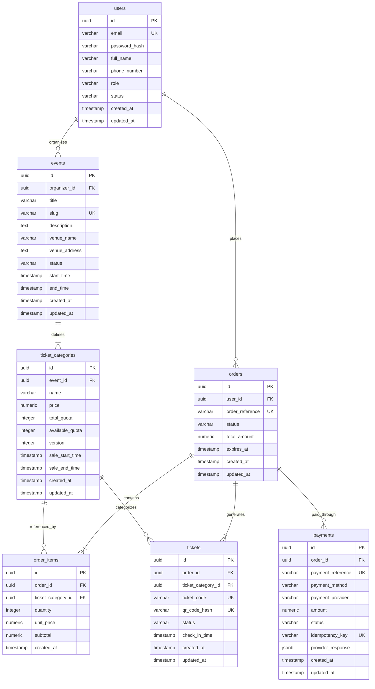

# Database Architecture and ERD Specification

This document defines the Phase 1 database schema and technical architecture for the Event and Ticketing Platform.
It follows Simplified Technical English (ASD-STE100) guidelines:
- Sentences are short, direct, and unambiguous (under 20 words where possible).
- Clear technical definitions and relational boundaries are established.

---

## 1. System Overview

The platform provides online event ticketing services.
Users can browse events, select ticket categories, reserve inventory, submit payments, and receive verifiable tickets.

### Core Modules and Separation of Concerns
1. **User Identity & Access**: Manages customer profiles, organizers, administrators, and credentials.
2. **Event & Inventory Catalog**: Manages event schedules, venues, and ticket category pricing and quotas.
3. **Order Lifecycle**: Manages temporary inventory holds, checkouts, and transactional states.
4. **Payment Gateway Integration**: Manages payment attempts, transaction IDs, statuses, and idempotency.
5. **Ticket Issuance & Validation**: Issues unique verifiable tickets with QR code identifiers for venue gate access.

---

## 2. Entity Relationship Diagram (ERD)



---

## 3. Detailed Data Dictionary

### 3.1 Table: `users`
Stores user identities, credentials, and authorization roles.

| Column | Type | Constraints | Description |
| :--- | :--- | :--- | :--- |
| `id` | UUID | PRIMARY KEY, DEFAULT `gen_random_uuid()` | Unique user identifier. |
| `email` | VARCHAR(255) | NOT NULL, UNIQUE | Normalized email address. |
| `password_hash` | VARCHAR(255) | NOT NULL | Secure salted password hash (e.g. Argon2id / bcrypt). |
| `full_name` | VARCHAR(150) | NOT NULL | Legal name of user. |
| `phone_number` | VARCHAR(32) | NULL | Contact mobile number with country code. |
| `role` | VARCHAR(32) | NOT NULL, DEFAULT `'customer'` | Role enum: `customer`, `organizer`, `admin`. |
| `status` | VARCHAR(32) | NOT NULL, DEFAULT `'active'` | Status: `active`, `suspended`, `unverified`. |
| `created_at` | TIMESTAMPTZ | NOT NULL, DEFAULT `NOW()` | Timestamp of record creation. |
| `updated_at` | TIMESTAMPTZ | NOT NULL, DEFAULT `NOW()` | Timestamp of last record update. |

---

### 3.2 Table: `events`
Stores event details, venue information, and scheduling.

| Column | Type | Constraints | Description |
| :--- | :--- | :--- | :--- |
| `id` | UUID | PRIMARY KEY, DEFAULT `gen_random_uuid()` | Unique event identifier. |
| `organizer_id` | UUID | NOT NULL, FK `users(id)` ON DELETE RESTRICT | Reference to event creator. |
| `title` | VARCHAR(255) | NOT NULL | Event title. |
| `slug` | VARCHAR(255) | NOT NULL, UNIQUE | URL-friendly slug. |
| `description` | TEXT | NULL | Detailed event description and guidelines. |
| `venue_name` | VARCHAR(255) | NOT NULL | Venue or stadium name. |
| `venue_address` | TEXT | NOT NULL | Physical venue address. |
| `status` | VARCHAR(32) | NOT NULL, DEFAULT `'draft'` | Status: `draft`, `published`, `sold_out`, `cancelled`, `completed`. |
| `start_time` | TIMESTAMPTZ | NOT NULL | Event start date and time. |
| `end_time` | TIMESTAMPTZ | NOT NULL | Event end date and time. |
| `created_at` | TIMESTAMPTZ | NOT NULL, DEFAULT `NOW()` | Timestamp of creation. |
| `updated_at` | TIMESTAMPTZ | NOT NULL, DEFAULT `NOW()` | Timestamp of last update. |

**Constraints:**
- `CHECK (end_time > start_time)`

---

### 3.3 Table: `ticket_categories`
Stores ticket tiers, quota pools, and prices for events.

| Column | Type | Constraints | Description |
| :--- | :--- | :--- | :--- |
| `id` | UUID | PRIMARY KEY, DEFAULT `gen_random_uuid()` | Unique ticket category identifier. |
| `event_id` | UUID | NOT NULL, FK `events(id)` ON DELETE CASCADE | Associated event. |
| `name` | VARCHAR(100) | NOT NULL | Category name (e.g. VIP, Early Bird, General Admission). |
| `price` | NUMERIC(14, 2) | NOT NULL | Base unit price in system currency. |
| `total_quota` | INTEGER | NOT NULL | Maximum total tickets allocated. |
| `available_quota`| INTEGER | NOT NULL | Currently unsold and unreserved ticket count. |
| `version` | INTEGER | NOT NULL, DEFAULT `0` | Optimistic concurrency control version counter. |
| `sale_start_time`| TIMESTAMPTZ | NOT NULL | Sale opening timestamp. |
| `sale_end_time` | TIMESTAMPTZ | NOT NULL | Sale closing timestamp. |
| `created_at` | TIMESTAMPTZ | NOT NULL, DEFAULT `NOW()` | Timestamp of creation. |
| `updated_at` | TIMESTAMPTZ | NOT NULL, DEFAULT `NOW()` | Timestamp of last update. |

**Constraints:**
- `CHECK (price >= 0)`
- `CHECK (total_quota >= 0)`
- `CHECK (available_quota >= 0 AND available_quota <= total_quota)`
- `CHECK (sale_end_time > sale_start_time)`
- `UNIQUE (event_id, name)`

---

### 3.4 Table: `orders`
Represents customer checkout reservations and orders.

| Column | Type | Constraints | Description |
| :--- | :--- | :--- | :--- |
| `id` | UUID | PRIMARY KEY, DEFAULT `gen_random_uuid()` | Unique order identifier. |
| `user_id` | UUID | NOT NULL, FK `users(id)` ON DELETE RESTRICT | Purchasing user. |
| `order_reference` | VARCHAR(64) | NOT NULL, UNIQUE | Human-readable unique code (e.g. `ORD-20261011-84920`). |
| `status` | VARCHAR(32) | NOT NULL, DEFAULT `'pending'` | Status: `pending`, `paid`, `cancelled`, `expired`. |
| `total_amount` | NUMERIC(14, 2) | NOT NULL | Final payable sum. |
| `expires_at` | TIMESTAMPTZ | NOT NULL | Expiration timestamp for payment hold (e.g. 15 minutes). |
| `created_at` | TIMESTAMPTZ | NOT NULL, DEFAULT `NOW()` | Timestamp of order placement. |
| `updated_at` | TIMESTAMPTZ | NOT NULL, DEFAULT `NOW()` | Timestamp of last update. |

**Constraints:**
- `CHECK (total_amount >= 0)`

---

### 3.5 Table: `order_items`
Detailed line items for ticket selections within an order.

| Column | Type | Constraints | Description |
| :--- | :--- | :--- | :--- |
| `id` | UUID | PRIMARY KEY, DEFAULT `gen_random_uuid()` | Unique order item identifier. |
| `order_id` | UUID | NOT NULL, FK `orders(id)` ON DELETE CASCADE | Parent order. |
| `ticket_category_id` | UUID | NOT NULL, FK `ticket_categories(id)` ON DELETE RESTRICT | Target ticket category. |
| `quantity` | INTEGER | NOT NULL | Number of tickets reserved. |
| `unit_price` | NUMERIC(14, 2) | NOT NULL | Unit price locked at time of order creation. |
| `subtotal` | NUMERIC(14, 2) | NOT NULL | Calculated subtotal (`quantity * unit_price`). |
| `created_at` | TIMESTAMPTZ | NOT NULL, DEFAULT `NOW()` | Timestamp of creation. |

**Constraints:**
- `CHECK (quantity > 0)`
- `CHECK (unit_price >= 0)`
- `CHECK (subtotal = quantity * unit_price)`
- `UNIQUE (order_id, ticket_category_id)`

---

### 3.6 Table: `payments`
Tracks payment transactions, payment gateway attempts, and webhooks.

| Column | Type | Constraints | Description |
| :--- | :--- | :--- | :--- |
| `id` | UUID | PRIMARY KEY, DEFAULT `gen_random_uuid()` | Unique payment identifier. |
| `order_id` | UUID | NOT NULL, FK `orders(id)` ON DELETE RESTRICT | Target order. |
| `payment_reference` | VARCHAR(128) | NOT NULL, UNIQUE | Gateway transaction reference or internal payment ID. |
| `payment_method` | VARCHAR(64) | NOT NULL | Method: `credit_card`, `bank_transfer`, `qris`, `e_wallet`. |
| `payment_provider` | VARCHAR(64) | NOT NULL | Provider name: `midtrans`, `xendit`, `stripe`. |
| `amount` | NUMERIC(14, 2) | NOT NULL | Transacted monetary amount. |
| `status` | VARCHAR(32) | NOT NULL, DEFAULT `'initiated'` | Status: `initiated`, `success`, `failed`, `refunded`, `expired`. |
| `idempotency_key` | VARCHAR(128) | NOT NULL, UNIQUE | Unique idempotency key to prevent double charging. |
| `provider_response` | JSONB | NULL | Raw response data or payload from payment gateway. |
| `created_at` | TIMESTAMPTZ | NOT NULL, DEFAULT `NOW()` | Timestamp of payment initiation. |
| `updated_at` | TIMESTAMPTZ | NOT NULL, DEFAULT `NOW()` | Timestamp of payment state update. |

**Constraints:**
- `CHECK (amount >= 0)`

---

### 3.7 Table: `tickets`
Represents individual issued event tickets with cryptographic verification codes.

| Column | Type | Constraints | Description |
| :--- | :--- | :--- | :--- |
| `id` | UUID | PRIMARY KEY, DEFAULT `gen_random_uuid()` | Unique ticket record identifier. |
| `order_id` | UUID | NOT NULL, FK `orders(id)` ON DELETE RESTRICT | Associated paid order. |
| `ticket_category_id` | UUID | NOT NULL, FK `ticket_categories(id)` ON DELETE RESTRICT | Ticket category. |
| `ticket_code` | VARCHAR(64) | NOT NULL, UNIQUE | Human-readable ticket reference (e.g. `TKT-9482-1029`). |
| `qr_code_hash` | VARCHAR(128) | NOT NULL, UNIQUE | Cryptographic hash / HMAC for QR scanner verification. |
| `status` | VARCHAR(32) | NOT NULL, DEFAULT `'valid'` | Status: `valid`, `used`, `revoked`. |
| `check_in_time` | TIMESTAMPTZ | NULL | Timestamp when scanned and checked in at venue gate. |
| `created_at` | TIMESTAMPTZ | NOT NULL, DEFAULT `NOW()` | Timestamp of ticket generation. |
| `updated_at` | TIMESTAMPTZ | NOT NULL, DEFAULT `NOW()` | Timestamp of status modification. |

---

## 4. Relational Integrity and Cascade Rules

1. **User Deletion**:
   - `events.organizer_id` -> `ON DELETE RESTRICT`: Prevents accidental deletion of users organizing active events.
   - `orders.user_id` -> `ON DELETE RESTRICT`: Keeps historical order records intact for financial auditing.
2. **Event Deletion**:
   - `ticket_categories.event_id` -> `ON DELETE CASCADE`: Deleting an unpublished draft event clears its categories.
   - If orders exist for any category, the application layer forbids hard event deletion (soft-deleting status `'cancelled'`).
3. **Order and Order Items**:
   - `order_items.order_id` -> `ON DELETE CASCADE`: If an order is purged, its line items are purged.
   - `order_items.ticket_category_id` -> `ON DELETE RESTRICT`: Deletion of a category with historical orders is disallowed.
4. **Payments and Tickets**:
   - `payments.order_id` -> `ON DELETE RESTRICT`: Retains financial transaction records.
   - `tickets.order_id` -> `ON DELETE RESTRICT`: Retains ticket records linked to financial transactions.
   - `tickets.ticket_category_id` -> `ON DELETE RESTRICT`: Preserves category references for checked-in tickets.

---

## 5. Concurrency and Race Condition Strategy

Ticket inventory booking is highly prone to race conditions during flash sales.
The system implements a multi-layer concurrency control model.

### 5.1 Atomic Pessimistic Row Locking (`SELECT ... FOR UPDATE`)
During order checkout, reserve tickets in an atomic database transaction:
```sql
BEGIN;

-- 1. Lock category row to serialize stock reservation
SELECT id, available_quota 
FROM ticket_categories 
WHERE id = :category_id 
FOR UPDATE;

-- 2. Validate quota availability
-- IF available_quota < :requested_quantity THEN ROLLBACK;

-- 3. Decrement stock atomically with constraint safety
UPDATE ticket_categories 
SET available_quota = available_quota - :requested_quantity,
    updated_at = NOW()
WHERE id = :category_id;

-- 4. Create order and order item with temporary expiration window
INSERT INTO orders (id, user_id, order_reference, status, total_amount, expires_at)
VALUES (:order_id, :user_id, :order_ref, 'pending', :total_amount, NOW() + INTERVAL '15 minutes');

INSERT INTO order_items (id, order_id, ticket_category_id, quantity, unit_price, subtotal)
VALUES (:item_id, :order_id, :category_id, :requested_quantity, :unit_price, :subtotal);

COMMIT;
```

### 5.2 Optimistic Concurrency Control (Fallback / High Concurrency)
Each category includes a `version` column.
Applications can perform conditional atomic decrements:
```sql
UPDATE ticket_categories
SET available_quota = available_quota - :quantity,
    version = version + 1,
    updated_at = NOW()
WHERE id = :category_id 
  AND version = :current_version 
  AND available_quota >= :quantity;
```
If row count returns 0, retry or inform user of stock exhaustion.

### 5.3 Automated Reservation Rollback for Expired Orders
Orders hold inventory for 15 minutes.
If payment is not confirmed before `expires_at`:
1. A background scheduler runs every minute.
2. Expired pending orders are marked `'expired'`.
3. Inventory is returned to `available_quota` atomically:
```sql
BEGIN;

WITH expired_orders AS (
    UPDATE orders
    SET status = 'expired', updated_at = NOW()
    WHERE status = 'pending' AND expires_at < NOW()
    RETURNING id
),
restored_items AS (
    SELECT oi.ticket_category_id, SUM(oi.quantity) AS qty
    FROM order_items oi
    JOIN expired_orders eo ON oi.order_id = eo.id
    GROUP BY oi.ticket_category_id
)
UPDATE ticket_categories tc
SET available_quota = tc.available_quota + ri.qty,
    updated_at = NOW()
FROM restored_items ri
WHERE tc.id = ri.ticket_category_id;

COMMIT;
```

---

## 6. Performance Indexing Strategy

Targeted indexes prevent table scans on high-traffic paths (event search, customer order lookups, and ticket validation).

### 6.1 Foreign Key Indexing
PostgreSQL does not index foreign keys automatically. Explicit B-Tree indexes are required:
```sql
CREATE INDEX idx_events_organizer_id ON events(organizer_id);
CREATE INDEX idx_ticket_categories_event_id ON ticket_categories(event_id);
CREATE INDEX idx_orders_user_id ON orders(user_id);
CREATE INDEX idx_order_items_order_id ON order_items(order_id);
CREATE INDEX idx_order_items_ticket_category_id ON order_items(ticket_category_id);
CREATE INDEX idx_payments_order_id ON payments(order_id);
CREATE INDEX idx_tickets_order_id ON tickets(order_id);
CREATE INDEX idx_tickets_ticket_category_id ON tickets(ticket_category_id);
```

### 6.2 Search, Filtering, and Lifecycle Indexing
```sql
-- Fast lookup for published upcoming events
CREATE INDEX idx_events_status_start_time ON events(status, start_time) 
WHERE status = 'published';

-- Full text search / trigram index for event search by title and venue
CREATE INDEX idx_events_title_trgm ON events USING gin (title gin_trgm_ops);

-- Rapid lookup for active reservations that need expiration monitoring
CREATE INDEX idx_orders_status_expires_at ON orders(status, expires_at) 
WHERE status = 'pending';

-- Instant gate scanning index for QR code hash lookups
CREATE INDEX idx_tickets_qr_code_hash ON tickets(qr_code_hash);

-- Idempotency verification index for payment webhooks
CREATE INDEX idx_payments_idempotency_key ON payments(idempotency_key);
```

---

## 7. Complete DDL Script (PostgreSQL 15+)

```sql
-- Enable necessary extensions
CREATE EXTENSION IF NOT EXISTS "uuid-ossp";
CREATE EXTENSION IF NOT EXISTS "pg_trgm";

-- 1. Users Table
CREATE TABLE users (
    id UUID PRIMARY KEY DEFAULT gen_random_uuid(),
    email VARCHAR(255) NOT NULL,
    password_hash VARCHAR(255) NOT NULL,
    full_name VARCHAR(150) NOT NULL,
    phone_number VARCHAR(32),
    role VARCHAR(32) NOT NULL DEFAULT 'customer',
    status VARCHAR(32) NOT NULL DEFAULT 'active',
    created_at TIMESTAMPTZ NOT NULL DEFAULT NOW(),
    updated_at TIMESTAMPTZ NOT NULL DEFAULT NOW(),
    CONSTRAINT uq_users_email UNIQUE (email),
    CONSTRAINT chk_users_role CHECK (role IN ('customer', 'organizer', 'admin')),
    CONSTRAINT chk_users_status CHECK (status IN ('active', 'suspended', 'unverified'))
);

-- 2. Events Table
CREATE TABLE events (
    id UUID PRIMARY KEY DEFAULT gen_random_uuid(),
    organizer_id UUID NOT NULL,
    title VARCHAR(255) NOT NULL,
    slug VARCHAR(255) NOT NULL,
    description TEXT,
    venue_name VARCHAR(255) NOT NULL,
    venue_address TEXT NOT NULL,
    status VARCHAR(32) NOT NULL DEFAULT 'draft',
    start_time TIMESTAMPTZ NOT NULL,
    end_time TIMESTAMPTZ NOT NULL,
    created_at TIMESTAMPTZ NOT NULL DEFAULT NOW(),
    updated_at TIMESTAMPTZ NOT NULL DEFAULT NOW(),
    CONSTRAINT uq_events_slug UNIQUE (slug),
    CONSTRAINT fk_events_organizer FOREIGN KEY (organizer_id) REFERENCES users(id) ON DELETE RESTRICT,
    CONSTRAINT chk_events_status CHECK (status IN ('draft', 'published', 'sold_out', 'cancelled', 'completed')),
    CONSTRAINT chk_events_time_sequence CHECK (end_time > start_time)
);

-- 3. Ticket Categories Table
CREATE TABLE ticket_categories (
    id UUID PRIMARY KEY DEFAULT gen_random_uuid(),
    event_id UUID NOT NULL,
    name VARCHAR(100) NOT NULL,
    price NUMERIC(14, 2) NOT NULL,
    total_quota INTEGER NOT NULL,
    available_quota INTEGER NOT NULL,
    version INTEGER NOT NULL DEFAULT 0,
    sale_start_time TIMESTAMPTZ NOT NULL,
    sale_end_time TIMESTAMPTZ NOT NULL,
    created_at TIMESTAMPTZ NOT NULL DEFAULT NOW(),
    updated_at TIMESTAMPTZ NOT NULL DEFAULT NOW(),
    CONSTRAINT uq_ticket_categories_event_name UNIQUE (event_id, name),
    CONSTRAINT fk_ticket_categories_event FOREIGN KEY (event_id) REFERENCES events(id) ON DELETE CASCADE,
    CONSTRAINT chk_ticket_categories_price CHECK (price >= 0),
    CONSTRAINT chk_ticket_categories_quota CHECK (total_quota >= 0 AND available_quota >= 0 AND available_quota <= total_quota),
    CONSTRAINT chk_ticket_categories_sale_window CHECK (sale_end_time > sale_start_time)
);

-- 4. Orders Table
CREATE TABLE orders (
    id UUID PRIMARY KEY DEFAULT gen_random_uuid(),
    user_id UUID NOT NULL,
    order_reference VARCHAR(64) NOT NULL,
    status VARCHAR(32) NOT NULL DEFAULT 'pending',
    total_amount NUMERIC(14, 2) NOT NULL,
    expires_at TIMESTAMPTZ NOT NULL,
    created_at TIMESTAMPTZ NOT NULL DEFAULT NOW(),
    updated_at TIMESTAMPTZ NOT NULL DEFAULT NOW(),
    CONSTRAINT uq_orders_reference UNIQUE (order_reference),
    CONSTRAINT fk_orders_user FOREIGN KEY (user_id) REFERENCES users(id) ON DELETE RESTRICT,
    CONSTRAINT chk_orders_status CHECK (status IN ('pending', 'paid', 'cancelled', 'expired')),
    CONSTRAINT chk_orders_total_amount CHECK (total_amount >= 0)
);

-- 5. Order Items Table
CREATE TABLE order_items (
    id UUID PRIMARY KEY DEFAULT gen_random_uuid(),
    order_id UUID NOT NULL,
    ticket_category_id UUID NOT NULL,
    quantity INTEGER NOT NULL,
    unit_price NUMERIC(14, 2) NOT NULL,
    subtotal NUMERIC(14, 2) NOT NULL,
    created_at TIMESTAMPTZ NOT NULL DEFAULT NOW(),
    CONSTRAINT uq_order_items_category UNIQUE (order_id, ticket_category_id),
    CONSTRAINT fk_order_items_order FOREIGN KEY (order_id) REFERENCES orders(id) ON DELETE CASCADE,
    CONSTRAINT fk_order_items_category FOREIGN KEY (ticket_category_id) REFERENCES ticket_categories(id) ON DELETE RESTRICT,
    CONSTRAINT chk_order_items_quantity CHECK (quantity > 0),
    CONSTRAINT chk_order_items_unit_price CHECK (unit_price >= 0),
    CONSTRAINT chk_order_items_subtotal CHECK (subtotal = quantity * unit_price)
);

-- 6. Payments Table
CREATE TABLE payments (
    id UUID PRIMARY KEY DEFAULT gen_random_uuid(),
    order_id UUID NOT NULL,
    payment_reference VARCHAR(128) NOT NULL,
    payment_method VARCHAR(64) NOT NULL,
    payment_provider VARCHAR(64) NOT NULL,
    amount NUMERIC(14, 2) NOT NULL,
    status VARCHAR(32) NOT NULL DEFAULT 'initiated',
    idempotency_key VARCHAR(128) NOT NULL,
    provider_response JSONB,
    created_at TIMESTAMPTZ NOT NULL DEFAULT NOW(),
    updated_at TIMESTAMPTZ NOT NULL DEFAULT NOW(),
    CONSTRAINT uq_payments_reference UNIQUE (payment_reference),
    CONSTRAINT uq_payments_idempotency UNIQUE (idempotency_key),
    CONSTRAINT fk_payments_order FOREIGN KEY (order_id) REFERENCES orders(id) ON DELETE RESTRICT,
    CONSTRAINT chk_payments_amount CHECK (amount >= 0),
    CONSTRAINT chk_payments_status CHECK (status IN ('initiated', 'success', 'failed', 'refunded', 'expired'))
);

-- 7. Tickets Table
CREATE TABLE tickets (
    id UUID PRIMARY KEY DEFAULT gen_random_uuid(),
    order_id UUID NOT NULL,
    ticket_category_id UUID NOT NULL,
    ticket_code VARCHAR(64) NOT NULL,
    qr_code_hash VARCHAR(128) NOT NULL,
    status VARCHAR(32) NOT NULL DEFAULT 'valid',
    check_in_time TIMESTAMPTZ,
    created_at TIMESTAMPTZ NOT NULL DEFAULT NOW(),
    updated_at TIMESTAMPTZ NOT NULL DEFAULT NOW(),
    CONSTRAINT uq_tickets_code UNIQUE (ticket_code),
    CONSTRAINT uq_tickets_qr_hash UNIQUE (qr_code_hash),
    CONSTRAINT fk_tickets_order FOREIGN KEY (order_id) REFERENCES orders(id) ON DELETE RESTRICT,
    CONSTRAINT fk_tickets_category FOREIGN KEY (ticket_category_id) REFERENCES ticket_categories(id) ON DELETE RESTRICT,
    CONSTRAINT chk_tickets_status CHECK (status IN ('valid', 'used', 'revoked'))
);

-- Secondary & Performance Indexes
CREATE INDEX idx_events_organizer_id ON events(organizer_id);
CREATE INDEX idx_ticket_categories_event_id ON ticket_categories(event_id);
CREATE INDEX idx_orders_user_id ON orders(user_id);
CREATE INDEX idx_order_items_order_id ON order_items(order_id);
CREATE INDEX idx_order_items_ticket_category_id ON order_items(ticket_category_id);
CREATE INDEX idx_payments_order_id ON payments(order_id);
CREATE INDEX idx_tickets_order_id ON tickets(order_id);
CREATE INDEX idx_tickets_ticket_category_id ON tickets(ticket_category_id);

CREATE INDEX idx_events_status_start_time ON events(status, start_time) WHERE status = 'published';
CREATE INDEX idx_events_title_trgm ON events USING gin (title gin_trgm_ops);
CREATE INDEX idx_orders_status_expires_at ON orders(status, expires_at) WHERE status = 'pending';
```

---

## 8. Summary of Architectural Guarantees

1. **Relational Integrity**: Foreign key rules guarantee referential consistency across all user journeys.
2. **Double-Booking Prevention**: Pessimistic `FOR UPDATE` locking and quota integrity check constraints eliminate negative quotas.
3. **Financial Consistency**: Idempotency keys protect payment transaction webhooks against duplicate charges.
4. **Sub-second Ticket Scanning**: Unique hashed QR codes backed by B-Tree indexes enable high-throughput gate verification.
